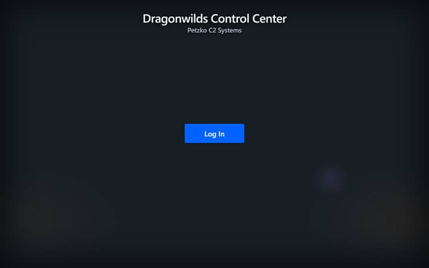
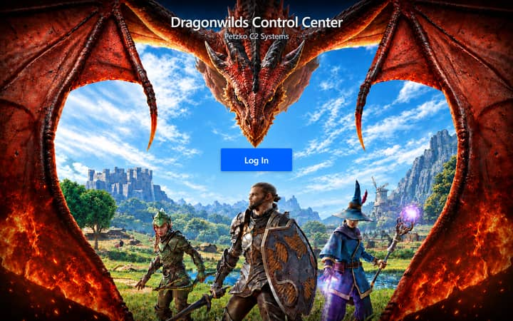
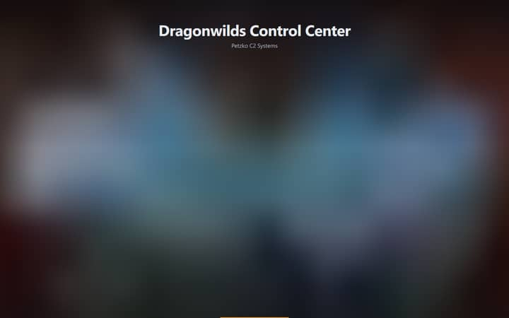
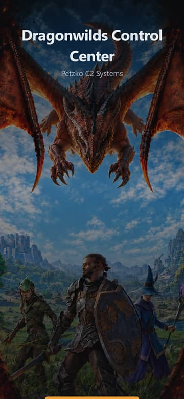

# Login page performance: root cause and fix plan

Status: analysis, 2026-10-17. Nothing in the product was changed. Everything below was measured against the real `rsdw-c2` binary built from commit `ee2746e` (see [Method](#method)), except where a line says *unverified*.

## TL;DR

The login scene ships **two 10 MB PNGs** (`dragonwilds-login-desktop-v1.png` is 10,624,327 bytes at 3840x2160; `-mobile-v1.png` is 10,163,172 bytes at 2160x4670), served **with no caching headers and no compression**, discovered **late** (only after `app.js` runs), and **requested by every visitor, including people who are already signed in**.

What a visitor experiences (Edge, real binary, desktop viewport, cold cache):

| Network | "Log In" button painted | First pixels of the artwork | Artwork fully received | Bytes transferred |
| --- | --- | --- | --- | --- |
| loopback (no throttle) | 0.31 s | 0.62 s | 0.13 s | 10.9 MB |
| 100 Mbps, 20 ms RTT | 0.15 s | 1.23 s | 1.09 s | 10.9 MB |
| 25 Mbps, 40 ms RTT | 0.27 s | 1.41 s | **3.81 s** | 10.9 MB |
| 9 Mbps, 150 ms RTT (decent LTE) | 0.63 s | 2.03 s | **10.3 s** | 10.9 MB |

A repeat visit costs the same as the first (10.9 MB again), because no static asset carries `Cache-Control`, `ETag` or `Last-Modified`.

A prototype that changes **only delivery** (responsive AVIF, tiny inline blurred placeholder, `preload`, `fetchpriority`, immutable caching, gzip) on the same throttle profiles:

| Network | Button painted | Placeholder visible | Artwork fully received | Bytes cold | Bytes warm |
| --- | --- | --- | --- | --- | --- |
| 100 Mbps | 0.13 s | 0.22 s | 0.11 s | 175 KB | **0** |
| 25 Mbps | 0.12 s | 0.20 s | 0.19 s | 175 KB | **0** |
| 9 Mbps | 0.31 s | 0.38 s | 0.57 s | 175 KB | **0** |

That is about **62x fewer bytes cold, and nothing warm**. The prototype is a static login page, not the React app. The React bundle will add JS, CSS and font bytes on top; the plan below sets a budget for them instead of predicting a number.

**What I could not reproduce:** a multi-second delay for the *button itself*. On this machine the button paints within 0.1-0.7 s in every baseline cell, including 9 Mbps with a 4x CPU slowdown. What takes seconds is the artwork, which streams in as a visible top-to-bottom wipe. If the button is slow on your real deployment, the likely causes (all *unverified*) are in [Why the button might still feel slow](#why-the-button-might-still-feel-slow). The fix plan removes or shrinks all of them, and the harness here can re-measure against production.

## Method

- **Machine and browser:** Windows 11, Microsoft Edge 155 (Chromium) headless, driven by Playwright 1.62.1 (the version pinned in `package.json`).
- **Server:** the actual Go service. Go is not installed on this machine, so I downloaded `go1.26.9` into a temp directory and built the repo at `ee2746e` with `go build -overlay`. The overlay swaps in copies of two files that stub `syscall.Flock` and directory `fsync`, which do not exist on Windows. The working tree was not modified, and the web handler, headers and embedded assets are the repository's own. Started with `RSDW_DEMO_DATA=true RSDW_ADMIN_TOKEN=... RSDW_LISTEN_ADDR=127.0.0.1:18080`. **Token mode is required**, because demo mode without a token auto-authenticates and never shows the login scene.
- **Network profiles** (CDP `Network.emulateNetworkConditions`): loopback; 100 Mbps/20 ms; 25 Mbps/40 ms; 9 Mbps/150 ms. **CPU:** none, or 4x main-thread slowdown.
- **Metrics:** Resource Timing for each request; a `MutationObserver` plus double `requestAnimationFrame` for "button painted"; and a CDP screencast whose frames I classify by how many pixels differ from the flat page colour (`#171f25`), giving "first pixels of the artwork" and a "visually complete" time. I did **not** use Largest Contentful Paint for the artwork, because Chrome excludes "elements that cover the full viewport, that are likely considered as background" ([web.dev, LCP](https://web.dev/articles/lcp)). The LCP element reported here is the `<h1>` (its inner span on the mobile layout).
- **Units:** "KB"/"MB" are decimal (1,000 bytes) for transfer sizes. The variant table in step 1 is printed by `optimize-hero.cjs` in KiB (1,024 bytes), so 170.3 "KB" there is 174,425 bytes.
- **Evidence tooling** is committed next to this file: `measure-login.cjs`, `optimize-hero.cjs`, `prototype-login-server.cjs`.

**Limits.** One machine, one run per cell (the numbers vary by tens of ms, so only differences above ~100 ms mean anything). Chromium only. Plain HTTP/1.1 on loopback: no TLS, no HTTP/2, no tunnel or ingress in the path. CDP's CPU throttle slows the main thread only, so it does not model a slow phone's *decode* threads. No real phone, no Safari, no Firefox.

## What the login path loads today

`web/index.html` is a static shell. `body.auth-locked` hides everything, and the login scene lives in a `<template>` that `web/app.js` clones at the very end of its first run (`lockedState()` on the last lines), **before** `/api/auth` has answered.

Measured response headers from the running binary:

| Resource | Size on the wire | Headers that matter |
| --- | --- | --- |
| `/` (index.html, hashes rewritten by `newWebHandler`) | 5.5 KB | `Cache-Control: no-store` |
| `/styles.css?v=<sha256>` | 52,971 B (9,417 B gzip, 8,268 B brotli) | **none** |
| `/app.js?v=<sha256>` | 228,031 B (56,204 B gzip, 45,551 B brotli) | **none**, no `Content-Encoding` |
| `/assets/dragonwilds-login-desktop-v1.png` | **10,624,327 B** | **none** |
| `/assets/dragonwilds-login-mobile-v1.png` | **10,163,172 B** | **none** |
| `/api/auth` | 356 B | `no-store` (correct) |

`http.FileServer` over an `embed.FS` sees a zero modification time, so it emits no `Last-Modified` and no `ETag`, and the code adds no `Cache-Control`. The `?v=<sha256>` rewrite in `newWebHandler` (`main.go:37-59`, issue #23) makes JS and CSS URLs content-addressed, but nothing tells the browser it may keep them. The PNGs are not versioned by hash at all (`-v1` is a manual suffix).

The artwork is referenced only from CSS (`web/styles.css:387` and `:411`), on `.login-scene`, which exists only after JS has run.

## Root causes

Ordered by impact on what you reported.

| # | Cause | Evidence | Effect |
| --- | --- | --- | --- |
| **F1** | Artwork is ~10 MB per image; shipped at print resolution for a background | 3840x2160 PNG for a 1280-wide window; 2160x4670 (10 MP) for a 390 CSS-px phone. AVIF at 1920w is 170 KB, mobile 750w is 93 KB (below) | 3.8 s at 25 Mbps, 10.3 s at 9 Mbps just to receive |
| **F2** | No HTTP caching on any static asset | No `Cache-Control`/`ETag`/`Last-Modified`; warm visit transferred 10,624,627 B again | Every visit and every OIDC round trip (`/` is reloaded after the IdP redirect) re-downloads everything |
| **F3** | No text compression | `app.js` 228 KB raw vs 56 KB gzip / 46 KB brotli; CSS 53 KB vs 9 KB gzip | ~5x more JS/CSS bytes than needed on the path to the button |
| **F4** | Late discovery, no priority hints | The image URL exists only in CSS on a JS-created element; no `<link rel=preload>`, no `fetchpriority`. Request starts 0.04 s (loopback) to 0.66 s (9 Mbps) after navigation, after JS runs | Artwork starts later than it could. web.dev: "Preload is still required for early discovery of LCP images included as CSS backgrounds" ([web.dev, Fetch Priority](https://web.dev/articles/fetch-priority)) |
| **F5** | One size per art direction, PNG only | `@media (max-width: 760px)` swaps the URL, nothing else. No `srcset`/`image-set`, no AVIF/WebP, no DPR awareness | A 1280x720 laptop window decodes a 3840x2160 bitmap |
| **F6** | Decode cost and memory | `createImageBitmap` of the PNGs takes **0.73-0.83 s** (desktop) and **0.84-0.85 s** (mobile) on this machine; a 3840x2160 RGBA bitmap is ~33 MB, the mobile one ~40 MB. The AVIFs decode in 0.03-0.32 s. CDP CPU throttling did not change PNG decode time because decode runs off the main thread, so a slow phone is *unmeasured* and likely worse | A visible "wipe" while bytes arrive; ~0.8 s extra after the last byte; memory pressure on small phones |
| **F7** | Login scene is rendered before auth is known, for everyone | Signed-in user, 9 Mbps: "Log In" painted at 0.61 s, dashboard at 1.43 s; at 25 Mbps 0.25 s vs 0.47 s. The 10.6 MB image request still ran to completion (10.3 s) | A flash of the login screen on every page load, and ~10 MB of wasted transfer per load for people who never needed the art |
| **F8** | The button depends on JS | `body.auth-locked` shows nothing until `app.js` (56 KB gzip, but sent as 228 KB) downloads and runs. At 4x CPU the button paints at 0.34 s (25 Mbps) and 0.71 s (9 Mbps) | The floor for "time to button". Not the multi-second problem here, but it grows on slow phones |
| **F9** | Hero composition fights legibility | The `<h1>` and "Petzko C2 Systems" sit on the dragon's face (screenshot below); two infinite-looping gradient animations (`login-glow`, `login-embers`) run on a full-viewport layer | Subtitle contrast is not controllable over a bright photographic area; continuous compositing costs battery. Design item, addressed in [design-brief.md](./design-brief.md) |

### A control that disproved one of my hypotheses

I expected the 10 MB hero to delay the signed-in dashboard by hogging bandwidth. I tested it by aborting the PNG request for a signed-in user:

| Network | Dashboard visible, hero downloading | Dashboard visible, hero blocked |
| --- | --- | --- |
| loopback | 217 ms | 178 ms |
| 25 Mbps | 473 ms | 493 ms |
| 9 Mbps | 1,427 ms | 1,475 ms |

No meaningful difference. The API calls are small and latency-bound, so I am **not** claiming contention. F7 stands on the other two costs: ~10 MB of pointless transfer (data caps, battery, a tunnel's egress) and the flash of the login scene.

### What the user sees



*Before, 9 Mbps, 0.63 s: the button is there, the page is flat.*



*Before, settled at ~10 s. Note the title and subtitle overlapping the dragon.*

### Why the button might still feel slow

*Unverified hypotheses, ranked.* None reproduced locally.

1. **Real hosting path.** A tunnel/ingress/TLS hop adds per-request latency and may not compress or cache what the origin does not mark cacheable. The button needs HTML, then JS (and CSS) as two further round trips. Measure it: `curl -w "%{time_starttransfer} %{time_total}\n" -o /dev/null -s https://<console>/app.js?v=...` from the owner's network.
2. **Slow uplink on the origin.** If the cluster is on a home connection, 280 KB of uncompressed JS+CSS plus a 10 MB image all leave through the same upload pipe.
3. **Phone CPU.** Parsing/executing 228 KB of JS before anything is interactive.
4. **Perception.** With a flat page and a progressive wipe, "the page" is not done until the art is, even though the button was usable earlier.

## Fix plan

Order is by payoff per effort. Steps 1-4 need no React and can ship immediately as **Phase 0** of the [migration plan](./react-migration-plan.md#phase-0-delivery-fixes-on-the-current-console), independent of the rewrite.

### 1. Re-encode and resize the artwork (F1, F5, F6)

Measured with `optimize-hero.cjs` (sharp 0.35.5, libvips 8.18.7, libaom 3.15.1):

| Variant | Dimensions | AVIF q45 | AVIF q60 | WebP q72 | JPEG q72 (mozjpeg, progressive) |
| --- | --- | --- | --- | --- | --- |
| Desktop 1280 | 1280x720 | **97 KB** | 169 KB | 174 KB | 172 KB |
| Desktop 1920 | 1920x1080 | **170 KB** | 282 KB | 297 KB | 331 KB |
| Desktop 2560 | 2560x1440 | **239 KB** | 387 KB | 413 KB | 499 KB |
| Mobile 750 | 750x1622 | **93 KB** | 152 KB | 163 KB | 186 KB |
| Mobile 1170 | 1170x2530 | **154 KB** | 245 KB | 267 KB | 343 KB |
| Inline placeholder | 24x14 / 24x52 | WebP 224 B / 478 B (data URI 323 / 663 chars) | | | |

- Ship **AVIF q45** as the primary, **WebP q72** as the fallback (one size each is enough for the fallback). Widths 1280/1920/2560 for desktop and 750/1170 for phones, chosen by `srcset` + `sizes="100vw"`.
- Visual check before accepting q45: the artwork is a painted scene with soft gradients, where AVIF at low quality can band. If banding shows in the sky, raise only the desktop-1920 and mobile-1170 variants to q52. Both stay under 220 KB.
- Bake any grading (darken the area behind the title, reduce saturation) into the encode. Do not do it with CSS `filter`, which costs GPU time on every frame.
- Keep the original PNGs out of `web/` (move to `docs/` or a release asset). They are 20 MB of the repo and of the binary today, for pixels nobody can use.
- Name files with a content hash (`hero-d-1920.3f9a1c.avif`) so they can be `immutable`. Vite does this automatically when the images are imported (in React) or placed in `src/`.

### 2. Make caching correct (F2)

Replace `newWebHandler`'s behaviour with this contract (full sketch in the [migration plan](./react-migration-plan.md#8-go-embedding-and-serving)):

| Path | `Cache-Control` | Validators |
| --- | --- | --- |
| `/`, `/index.html` and SPA fallbacks | `no-cache` | strong `ETag` (sha256 of the rendered body); 304 on match |
| `/assets/<name>.<hash>.<ext>` | `public, max-age=31536000, immutable` | none needed |
| any other static file (favicon, robots) | `no-cache` | `ETag` |
| `/api/*` | `no-store` (unchanged) | |

`no-cache` with an `ETag` replaces `no-store` on the HTML shell. The shell contains no secrets, and `no-store` blocks cheap revalidation. `web_test.go` asserts `no-store` on `/` today, so that assertion changes deliberately.

### 3. Compress text (F3)

Precompress at build time (`.br` and `.gz` next to each JS/CSS/HTML/SVG file; Vite plugin `vite-plugin-compression2` 2.5.3 or a 20-line script) and let Go choose by `Accept-Encoding` (`br`, then `gzip`), with `Vary: Accept-Encoding`. No new Go dependency: Go only reads precompressed bytes. Expected: `app.js` 228 KB to ~46 KB on the wire today, and the React bundle compresses the same way. Images are never recompressed.

### 4. Stop painting the login scene before auth is known (F7, F8)

- `index.html` ships a real **boot shell**: flat `#111210`, the wordmark, and "Connecting..." in plain HTML/CSS. It paints before any JS runs, and it contains **no hero and no login button**.
- The login screen (with hero) mounts only when `/api/auth` returns `authenticated:false`. Signed-in users never fetch the hero and never see a login flash.
- To hide the extra round trip for signed-out users:
  - **Placeholder first.** A 0.3-0.7 KB blurred WebP data URI as the scene background (visible at ~0.2 s in the prototype), then the AVIF fades in (`opacity` transition 350 ms, off under `prefers-reduced-motion`).
  - **Early hint, optional.** The Go handler for `/` knows whether the OIDC session cookie is valid (it already authenticates cookies). When it is not, add `Link: </assets/hero-d-1920.<hash>.avif>; rel=preload; as=image; fetchpriority=high` to the HTML response. In token mode the secret lives in `sessionStorage`, which the server cannot see, so use a 3-line inline `<script>` in `<head>` that inserts the same `<link rel="preload">` only when `sessionStorage['rsdw-admin-token']` is absent.
- Use a real `<picture>` with ``, not a CSS background, so `srcset`, intrinsic size and priority all apply (prototype markup in `prototype-login-server.cjs`).

### 5. Re-measure and gate (all)

- Re-run `measure-login.cjs` after each phase on the same profiles and record the table above in the PR.
- Add the automated checks in the [acceptance checklist](./react-migration-plan.md#10-acceptance-checklist): cold-cache login transfers **<= 300 KB** in Phase 0 (legacy JS+CSS gzip + hero) and **<= 450 KB** from the React phases (JS+CSS+fonts+hero, compressed; proposal until the Phase 1 spike measures the framework floor), warm login transfers **<= 10 KB** (12 KB with React), every `/assets/*` response is `immutable`, no image over 250 KB, no request for a hero when signed in. These are deterministic byte and header assertions, not flaky timings.

## Prototype results (delivery only)

Same harness and profiles. Source: static page from `prototype-login-server.cjs` (inline LQIP, `<picture>`, preload with `fetchpriority`, `immutable` assets, gzip HTML). The button there is bottom-cropped because of my throwaway layout. Ignore its position; the timings are what matter.

| Profile | Device | CPU | Button painted | First artwork pixels (placeholder) | Artwork fully received | Cold bytes | Warm bytes |
| --- | --- | --- | --- | --- | --- | --- | --- |
| loopback | desktop | 1x | 127 ms | 288 ms | 14 ms | 175 KB | 0 |
| loopback | mobile | 1x | 70 ms | 169 ms | 23 ms | 159 KB | 0 |
| 100 Mbps | desktop | 1x | 125 ms | 221 ms | 111 ms | 175 KB | 0 |
| 100 Mbps | mobile | 1x | 128 ms | 238 ms | 110 ms | 159 KB | 0 |
| 25 Mbps | desktop | 1x | 121 ms | 204 ms | 191 ms | 175 KB | n/a |
| 25 Mbps | mobile | 4x | 311 ms | 344 ms | 250 ms | 159 KB | n/a |
| 9 Mbps | desktop | 1x | 307 ms | 383 ms | 572 ms | 175 KB | n/a |
| 9 Mbps | mobile | 4x | 431 ms | 484 ms | 561 ms | 159 KB | n/a |

Baseline for the same cells: see [Raw numbers](#raw-numbers). For example mobile at 9 Mbps and 4x CPU: button 0.71 s, artwork received 9.92 s, 10.4 MB.



*Prototype, 9 Mbps: at the moment the button paints, the page already has atmosphere instead of a flat fill.*



*Prototype mobile, settled: 93 KB image, same scene.*

## Raw numbers

Decode (`createImageBitmap`, Edge, this machine, 3 runs each, ms):

| Image | 1x CPU | 4x CPU | 6x CPU |
| --- | --- | --- | --- |
| PNG desktop 3840x2160 (10.6 MB) | 799, 828, 728 | 820, 713, 609 | 754, 691, 699 |
| PNG mobile 2160x4670 (10.2 MB) | 852, 846, 840 | 883, 832, 631 | 880, 890, 1129 |
| AVIF desktop 1920x1080 (174 KB) | 289, 287, 316 | 135, 69, 284 | 162, 296, 196 |
| AVIF mobile 750x1622 (95 KB) | 203, 26, 180 | 202, 16, 33 | 38, 93, 36 |

Baseline login, cold cache, every cell (ms; `imgEnd` = last byte of the artwork, `vc` = last visible change):

| Profile | Device | CPU | Button painted | First artwork pixels | `imgStart` | `imgEnd` | `vc` | Transfer |
| --- | --- | --- | --- | --- | --- | --- | --- | --- |
| loopback | desktop | 1x | 308 | 615 | 66 | 128 | 615 | 10.9 MB |
| loopback | mobile | 1x | 182 | 443 | 38 | 97 | 541 | 10.4 MB |
| 100 Mbps | desktop | 1x | 153 | 1,234 | 141 | 1,089 | 1,234 | 10.9 MB |
| 100 Mbps | mobile | 1x | 268 | 1,288 | 144 | 1,077 | 1,288 | 10.4 MB |
| 25 Mbps | desktop | 1x | 271 | 1,411 | 260 | 3,806 | 3,858 | 10.9 MB |
| 25 Mbps | mobile | 1x | 261 | 1,417 | 252 | 3,671 | 3,473 | 10.4 MB |
| 25 Mbps | mobile | 4x | 338 | 1,441 | 295 | 3,673 | n/a | 10.4 MB |
| 9 Mbps | desktop | 1x | 628 | 2,032 | 616 | 10,315 | 9,861 | 10.9 MB |
| 9 Mbps | mobile | 1x | 649 | 1,868 | 636 | 9,920 | 9,881 | 10.4 MB |
| 9 Mbps | mobile | 4x | 710 | 1,900 | 662 | 9,922 | n/a | 10.4 MB |

Warm-cache repeat at 100 Mbps: `imgEnd` 1,083 ms and 10,624,627 B transferred, identical to cold.

## Reproduce

```sh
# 1. a server in TOKEN mode (demo mode alone auto-authenticates)
RSDW_DEMO_DATA=true RSDW_ADMIN_TOKEN=local-measure-token RSDW_LISTEN_ADDR=127.0.0.1:18080 go run .
# 2. harness
cd docs/design/login-performance && npm i playwright@1.62.1 sharp
node measure-login.cjs http://127.0.0.1:18080 baseline
WARM=1 node measure-login.cjs http://127.0.0.1:18080 baseline loopback,broadband-100Mbps-20ms
CPU=4 node measure-login.cjs http://127.0.0.1:18080 cpu4 "broadband-25Mbps-40ms,lte-9Mbps-150ms" mobile
AUTHED=1 node measure-login.cjs http://127.0.0.1:18080 authed "loopback,broadband-25Mbps-40ms" desktop
# 3. prototype
node optimize-hero.cjs ../../.. . && node prototype-login-server.cjs   # serves :18081
node measure-login.cjs http://127.0.0.1:18081 prototype
```

On a Linux box with Chromium, change `channel: 'msedge'` to the default Chromium. On Windows, `go run .` fails to compile (`syscall.Flock`); build on Linux/WSL/macOS or use the overlay described under Method.

## Sources

- [web.dev: Largest Contentful Paint](https://web.dev/articles/lcp) (full-viewport background exclusion; background-image LCP candidates)
- [web.dev: Optimize resource loading with Fetch Priority](https://web.dev/articles/fetch-priority) (`fetchpriority="high"`; preload for CSS-background LCP images; last updated 2023-11-14)
- [web.dev: Web Vitals](https://web.dev/articles/vitals) (LCP <= 2.5 s, INP <= 200 ms, CLS <= 0.1 at p75; last updated 2024-10-31)

## Results: Phase 0 shipped

Status: implemented on the current vanilla console (issue #67). Measured with the harness above, unchanged except for one tweak in `AUTHED=1` mode: it no longer waits 90 s for a login button that a signed-in visitor correctly never sees (it now waits at most 50 ms for the button and then times the dashboard). Same machine, Edge 155, real Go binary in token mode, same four network profiles and CPU settings. Before is `origin/main` at `3c88441`; after is the Phase 0 branch. Each cell is one run, so only differences above ~100 ms mean anything. Format: before -> after.

| Profile | Device | CPU | Button painted | First artwork pixels | Artwork fully received | Cold bytes | Warm bytes |
| --- | --- | --- | --- | --- | --- | --- | --- |
| loopback | desktop | 1x | 101 ms -> 105 ms | 353 ms -> 215 ms | 152 ms -> 65 ms | 10.9 MB -> 241 KB | 10.9 MB -> 661 B |
| loopback | mobile | 1x | 144 ms -> 106 ms | 350 ms -> 215 ms | 73 ms -> 49 ms | 10.4 MB -> 224 KB | 10.4 MB -> 661 B |
| broadband-100Mbps-20ms | desktop | 1x | 127 ms -> 171 ms | 1,152 ms -> 260 ms | 1,043 ms -> 210 ms | 10.9 MB -> 241 KB | 10.9 MB -> 661 B |
| broadband-100Mbps-20ms | mobile | 1x | 181 ms -> 159 ms | 1,142 ms -> 979 ms | 1,029 ms -> 201 ms | 10.4 MB -> 224 KB | 10.4 MB -> 661 B |
| broadband-25Mbps-40ms | desktop | 1x | 260 ms -> 246 ms | 1,382 ms -> 333 ms | 3,790 ms -> 362 ms | 10.9 MB -> 241 KB | n/a -> n/a |
| broadband-25Mbps-40ms | mobile | 1x | 259 ms -> 253 ms | 1,376 ms -> 390 ms | 3,605 ms -> 370 ms | 10.4 MB -> 224 KB | n/a -> n/a |
| broadband-25Mbps-40ms | mobile | 4x | 314 ms -> 370 ms | 1,417 ms -> 475 ms | 3,638 ms -> 480 ms | 10.4 MB -> 224 KB | n/a -> n/a |
| lte-9Mbps-150ms | desktop | 1x | 630 ms -> 620 ms | 1,854 ms -> 710 ms | 10,319 ms -> 941 ms | 10.9 MB -> 241 KB | n/a -> n/a |
| lte-9Mbps-150ms | mobile | 1x | 617 ms -> 586 ms | 1,846 ms -> 741 ms | 9,881 ms -> 905 ms | 10.4 MB -> 224 KB | n/a -> n/a |
| lte-9Mbps-150ms | mobile | 4x | 699 ms -> 745 ms | 1,893 ms -> 898 ms | 9,927 ms -> 1,048 ms | 10.4 MB -> 224 KB | n/a -> n/a |

| Profile (desktop, signed in) | Dashboard visible | Artwork requested | Bytes |
| --- | --- | --- | --- |
| loopback | 161 ms -> 120 ms | yes (97 ms to finish) -> no | 10.9 MB -> 79 KB |
| broadband-25Mbps-40ms | 388 ms -> 376 ms | yes (3,765 ms to finish) -> no | 10.9 MB -> 79 KB |
| lte-9Mbps-150ms | 1,447 ms -> 1,089 ms | yes (10,302 ms to finish) -> no | 10.9 MB -> 79 KB |

Warm bytes are the repeat visit in the same browser context (HTML revalidated with `If-None-Match`; script, stylesheet and artwork served from cache). Warm cells were only measured on loopback and 100 Mbps, as in the baseline.

### What changed in the numbers

- **Bytes.** Cold login went from 10.9 MB to 241 KB (desktop, 1440 px wide window, 1920 px AVIF) and 224 KB (phone, 1170 px AVIF); the repeat visit went from the full 10.9 MB to 661 B. The signed-in load went from 10.9 MB to 79 KB because the artwork is no longer requested at all.
- **Artwork.** Fully received at 9 Mbps / 150 ms: 10.3 s -> 0.94 s (desktop) and 9.9 s -> 0.91 s (phone); at 25 Mbps 3.8 s -> 0.36 s. The inline blurred placeholder gives the page its colours at 0.2-0.7 s, before the AVIF arrives and fades in.
- **"Log In" button.** Essentially unchanged (0.10 s loopback, 0.25 s at 25 Mbps, 0.6-0.75 s at 9 Mbps, 4x CPU included). It was never the multi-second part, and it is still gated on HTML -> script -> `/api/auth`. The 1.0 s lab target for 9 Mbps / 4x CPU holds (745 ms). On every throttled profile the button paints before the artwork finishes (on loopback both land within ~50 ms of each other), and `tests/login-budget.cjs` asserts that ordering deterministically by holding the artwork response.
- **Signed in.** No artwork request, no login flash (the budget test records any `.login-scene` / `open-login` mutation and fails if one appears). Dashboard visible 161 ms -> 120 ms (loopback) and 1,447 ms -> 1,089 ms (9 Mbps), since the boot shell replaces the extra login-scene render.
- **Caveat on one cell.** "First artwork pixels" for 100 Mbps / mobile reads 979 ms. The harness classifies screencast frames by how far they differ from the flat page colour, and the dark-blue phone placeholder only crossed its threshold late in that run. The artwork itself was fully received at 201 ms, and the other mobile cells show the placeholder at 0.2-0.9 s.

### Deviations from the plan above

- **No `<link rel=preload>` for the artwork.** The page cannot know it is signed out before `/api/auth` answers (the OIDC session is an HttpOnly cookie and the token mode secret lives in `sessionStorage`), and the Phase 0 requirement is that signed-in visitors never fetch the hero. The `<picture>` is therefore created the moment `/api/auth` reports signed out, with `fetchpriority="high"` and `decoding="async"`; its request starts within a few ms of the button painting (`imgStart` in the table data, e.g. 245 ms vs button 246 ms at 25 Mbps).
- **WebP fallback is one 1280-px file per art direction** (171 KB desktop, 162 KB phone), not the 1920-px WebP from the prototype (297 KB), so every shipped image stays under the 250 KB budget, which the Go tests enforce. AVIF is q45 for all five sizes; I looked at the 1440 px desktop and 390 px @3x phone renders and saw no banding in the sky, so no q52 bump was needed.
- **Lighthouse CI is not part of this change.** Issue #67 mentions it; this PR covers the deterministic byte/header budget in Playwright (`tests/login-budget.cjs`, run from `scripts/verify.sh`) only.
- The artwork is generated by `scripts/build-login-art.cjs` (needs `sharp`, now a pinned devDependency) from the original PNGs, which are no longer in the tree; the script header says how to extract them from history (`f8dffc9`).
