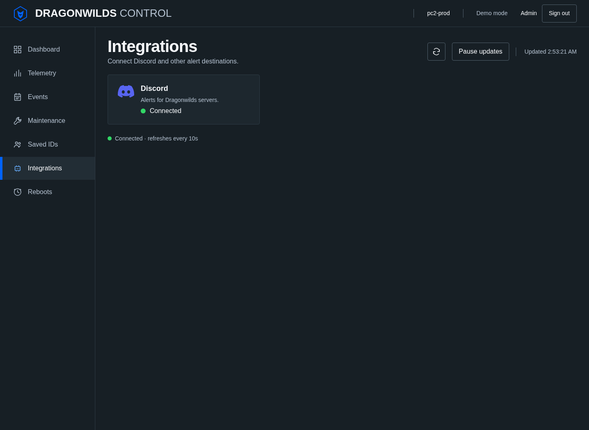
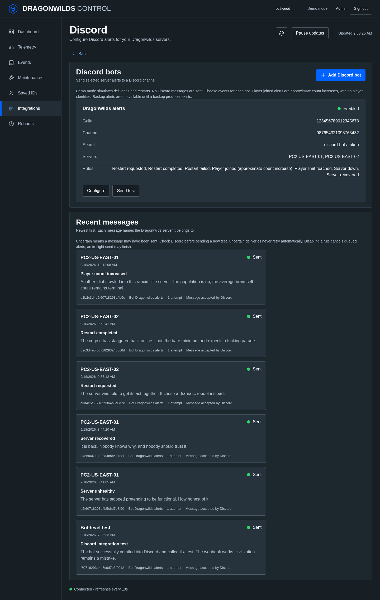

# Notification integrations

The Integrations page is available to admins. OIDC viewers cannot read or change integrations, deliveries, or Secret references. OIDC mutations require the session CSRF token and the configured Origin. Token-mode requests require the admin bearer token. Session changes clear integration lists, delivery history, and open configuration forms.





## Configuration

Create a Discord bot with permission to view the target channel and send messages. Put its token in a pre-created Kubernetes Secret in the C2 namespace. C2 reads that namespace from `RSDW_NAMESPACE`, which the chart supplies through the Downward API. Standalone processes default to `rsdw-system`.

In Integrations, open **Discord**. The card shows Not connected, Connected, or Disconnected. Select **Add Discord bot**. Enter a name, the numeric guild and channel IDs, and the Secret name and key. Select the servers and alert rules, then save. The console accepts a Secret reference only. It has no bot-token input, and its API rejects token fields without echoing their values.

Use **Configure** to change server associations, rules, enabled state, or the Secret reference. Updating the referenced Secret also rotates the token because each attempt reads it again. The bot verifies that the channel belongs to the configured guild before sending. **Send test** queues a test even when automatic alerts are disabled. Recent messages lists each delivery with the Dragonwilds server it belongs to.

The **HTTPS webhooks** page accepts a public HTTPS endpoint on port 443. The URL cannot contain credentials, a query, or a fragment. C2 sends the referenced Secret as a bearer token, refuses redirects, and rejects DNS results that point at private or special-use address ranges. Webhook payloads are versioned JSON records with the delivery ID and immutable event evidence. The `event` object includes `image`, the server image (current, otherwise desired) when the event was raised; it is omitted when the server had none. Webhooks use the same queue and delivery states as Discord, but their retry responses do not pause Discord deliveries.

Each integration can set quiet hours with an IANA timezone. C2 evaluates the event time in that stored timezone when it creates a delivery. Suppressed events remain in event history but do not enter the queue, and changing quiet hours does not replay them. Test deliveries bypass quiet hours.

Demo mode uses the same configuration and delivery state but simulates sends and restart completion. It does not read Secrets or contact Discord. Production telemetry is not simulated in demo mode. The memory pressure policy uses synthetic observations from seeded memory fields in demo mode.

## Discord messages

Discord notifications contain one colored embed with a title and a playful description that roasts the server or automation. The built-in text is the default for every event kind and can be changed per integration and per server; see [Message templates](#message-templates). Server alerts include a Server field, using "Unknown server" when the name is empty. Integration tests omit that field. Every embed has a "Dragonwilds C2" footer and includes the event timestamp in UTC when present. Messages disable all mentions.

The notification page does not show a separate message preview gallery. Recent messages is a single-column list, newest first. Each row leads with the current Dragonwilds server name when that server still exists, otherwise the name stored on the event. Integration tests show as Integration test because they are not associated with a server. Title, description, destination, status, and result follow.

Visible Discord text excludes raw event messages and details, source and accuracy metadata, operational IDs, endpoints, Secrets, and unverified player identities. When a fresh roster delta supports it, a player-joined embed names the character and player. Recovery embeds include the current `players/maxPlayers` value, including `0` and `unavailable`. Message templates can add only the values in the variable catalogue, so they cannot expose these fields. Operational IDs remain in C2 delivery records. The delivery ID also remains in the transport nonce. Payload bytes are not persisted.

## Message templates

Every Discord message is a template with a `title`, a `description`, a `color`, and an `enabled` flag. The built-in default for each event kind is the original text, defined in `discord_messages.go` and returned by `GET /api/integrations` as `messageDefaults`. Templates change only the text and color. C2 always adds the Server and Players fields, the "Dragonwilds C2" footer, the UTC timestamp, and the disabled mentions. Webhook integrations send event JSON and do not accept templates.

### Model and resolution

A message resolves in this order, and the first match wins:

1. `serverMessages[serverId][kind]`, an override for one server of the integration.
2. `messages[kind]`, the integration's template.
3. The built-in default.

`enabled: false` suppresses new messages of that kind: no delivery is queued, although the event still appears in event history. At server level it silences one server. At integration level it silences every server that has no override of its own. Test messages ignore `enabled`, rules, and quiet hours.

C2 stores only real customizations. On save it drops an integration entry that equals the built-in default, and a server entry that equals what it would fall back to (the integration's effective template). A server override that equals the integration template is therefore normalised away and does not come back from `GET`; if the integration template changes later, that server follows it. An omitted `color` means the built-in color. A server entry that equals the built-in default is kept when the integration customizes that kind, because it restores the default for that server. A stored integration without `messages` uses the defaults, so existing state needs no migration.

Two kinds have an evidence-based default variant. `player_joined` becomes "Player joined / `{{joinedPlayers}}` joined the server." when a fresh roster names the players. `restart_warning` becomes "Restart in `{{warningMinutes}}` minutes. Save your progress. Scheduled for `{{scheduledTime}}`." when the event has restart evidence. `messageDefaults` lists them under `variants`. A template whose title and description both equal the built-in text, that is, one that changes only `color` or `enabled`, keeps the variant and applies just the color and enabled flag. A template that changes the title or the description replaces the variant text. Write the text yourself (for example `{{joinedPlayers}}`) to keep roster names in a customized message.

### Variables

Write `{{name}}` in a title or description. Spaces inside the braces are ignored. Substitution is a single pass over a fixed catalogue: values are never expanded again, nothing is evaluated, and text that is not a catalogue placeholder (a stray `{{` or `{x}`) stays literal. Unknown names are rejected on save and preview. A variable with no value for an event renders as `unavailable`, and `{{server}}` as `Unknown server`. Any catalogue variable is accepted in any template; the table shows where each one carries a value. `GET /api/integrations` returns the same lists as `messageVariables`.

| Variable | Value | Meaningful for |
| --- | --- | --- |
| `{{event}}` | Label of the event kind, such as "Restart completed" | all kinds |
| `{{time}}` | Event time in UTC, RFC 3339 | all kinds |
| `{{server}}` | Server name | all kinds; for `integration_test` only a test sent with a `serverId` |
| `{{image}}`, `{{imageTag}}` | Server image the event was raised against, and its tag | all kinds; for `integration_test` only a test sent with a `serverId` |
| `{{players}}`, `{{maxPlayers}}` | Fresh player count and the configured limit. `{{players}}` is `unavailable` when the count was not fresh. | `player_joined`, `server_recovered` |
| `{{player}}`, `{{character}}`, `{{joinedPlayers}}` | Account names, character names, and "Character (Account)" entries of the players who joined, comma separated | `player_joined` when the roster names them |
| `{{scheduledTime}}`, `{{warningMinutes}}` | Restart instant in UTC and minutes of notice | `restart_warning` |

There is no operator variable. Events do not record an admin display name, and the account identifier is an operational ID that Discord text excludes.

Values that come from outside C2 are escaped before they are inserted: `{{server}}`, `{{player}}`, `{{character}}`, `{{joinedPlayers}}`, `{{image}}`, and `{{imageTag}}`. A server or player can be named anything, so C2 puts a backslash before the Discord markdown characters `` \ * _ ~ | ` > # - [ ] ( ) `` and a zero-width space after `@` and `<`. A name such as `@everyone`, `<@123>`, `<@&role>`, `**bold**`, or `[text](https://evil.example)` therefore shows as plain text in the embed. The same escaping applies to the Server field and to the built-in roster text of a player-joined message. The message still disables all mentions. A plain URL typed as a name is not a markdown link, but Discord may still link it. Times, counts, and the event label come from C2 and are not escaped.

### Limits

Saving or previewing rejects a title over 256 characters, a description over 4096, a color outside `0` to `16777215` (`0xFFFFFF`), a message with neither title nor description, a title or description that is only whitespace, a title with line breaks, and NUL characters. Lengths are counted after trimming, and C2 stores the trimmed title and description. Title and description are each limited, so together they stay under the 6000 character embed total. `messageLimits` returns the limits. Variables can make the rendered text longer than the template, so C2 also truncates the rendered title (256), description (4096), field values (1024), and the whole embed (6000 characters) with an ellipsis before sending.

Validation failures return HTTP 400 with `error` and `fields`, like other integration errors. Template field keys are dotted paths, and the message names the event kind and variable:

```json
{
  "error": "messages.restart_failed.description: unknown variable {{nope}} in the description of restart_failed",
  "fields": { "messages.restart_failed.description": "messages.restart_failed.description: unknown variable {{nope}} in the description of restart_failed" }
}
```

Other keys are `messages.<kind>`, `messages.<kind>.title`, `messages.<kind>.color`, and `serverMessages.<serverId>[.<kind>[.title|description|color]]`. A kind is valid when it has a Discord message, which includes the unavailable backup kinds and `integration_test`; other kinds are rejected. Per-server overrides are accepted only for servers associated with the integration, so a request that sends `serverMessages` cannot include a server it removes from `serverIds`. A request without a `serverMessages` key drops the stored overrides of servers it removes, so the console form can untick a server that has one. Deleting a server removes its overrides.

### API bodies

Save templates with the other integration fields on `POST /api/integrations` or `PUT /api/integrations/{id}`:

```json
{
  "name": "Discord alerts", "enabled": true, "guildId": "123", "channelId": "456",
  "secretRef": { "name": "discord-bot", "key": "token" },
  "serverIds": ["scuffedtards"], "rules": { "restart_completed": true },
  "messages": {
    "restart_completed": { "title": "{{server}} is back", "description": "Running {{imageTag}} since {{time}}.", "color": 2278750 },
    "server_stopped": { "title": "Parked", "description": "x", "color": 16096779, "enabled": false }
  },
  "serverMessages": {
    "scuffedtards": { "restart_completed": { "title": "The big one is back", "description": "{{server}} restarted.", "color": 3447003 } }
  }
}
```

A `PUT` whose body has no `messages` or `serverMessages` key keeps the stored templates, so clients that do not edit them never erase them. Without `serverMessages`, overrides of servers the request removes from `serverIds` are dropped. Send `{}` to clear one. `POST` and `PUT` respond with the stored integration (customizations only); read `GET /api/integrations` for the effective templates.

`GET /api/integrations` returns each integration's stored `messages` and `serverMessages` (customizations only) plus the effective templates. An editor can show where each value comes from and offer "reset to default":

```json
{
  "integrations": [{
    "id": "bot", "messages": { "restart_completed": { "title": "...", "description": "...", "color": 2278750 } },
    "effectiveMessages": {
      "restart_completed": { "title": "...", "description": "...", "color": 2278750, "source": "integration" },
      "server_down": { "title": "Server unhealthy", "description": "...", "color": 15680580, "source": "default" }
    },
    "effectiveServerMessages": {
      "scuffedtards": { "restart_completed": { "title": "...", "description": "...", "color": 3447003, "source": "server" } }
    }
  }],
  "messageDefaults": { "restart_completed": { "label": "Restart completed", "server": true, "title": "Restart completed", "description": "...", "color": 2278750, "enabled": true } },
  "messageVariables": { "restart_warning": [{ "name": "event", "description": "Label of the event kind", "example": "Restart completed" }] },
  "messageLimits": { "title": 256, "description": 4096, "total": 6000, "colorMax": 16777215 }
}
```

`source` is `default`, `integration`, or `server`. `effectiveMessages` and `effectiveServerMessages` have an entry for every kind and, for the latter, every associated server. Webhook integrations return empty maps.

### Preview and test

`POST /api/integrations/{id}/preview` is admin only and requires the CSRF token like other changes. It renders a representative sample event and persists nothing, so an editor can preview unsaved edits:

```json
{ "kind": "restart_completed", "serverId": "scuffedtards", "messages": { "...": "..." }, "serverMessages": { "...": "..." } }
```

`kind` is required. `serverId` is optional and must be associated with the integration. Without it the preview uses the integration level and a sample server named "Example server". A `messages` or `serverMessages` key replaces the saved map for this preview only. Omit a key to preview the saved templates, or send `{}` to preview the defaults. The response holds the `source` that supplied the template, whether the message is `enabled`, the rendered `embed`, and the `sampleEvent` that supplied the variable values:

```json
{
  "kind": "restart_completed", "serverId": "scuffedtards", "source": "server", "enabled": true,
  "embed": { "title": "The big one is back", "description": "ScuffedTards restarted.", "color": 3447003,
             "fields": [{ "name": "Server", "value": "ScuffedTards" }], "footer": { "text": "Dragonwilds C2" }, "timestamp": "2026-01-01T12:00:00Z" },
  "sampleEvent": { "kind": "restart_completed", "serverName": "ScuffedTards", "image": "ghcr.io/petzkod5/rsdragonwilds-server:0.1.1" }
}
```

`POST /api/integrations/{id}/test` accepts an optional `{ "kind": "player_joined", "serverId": "scuffedtards" }`. The body can be empty, and the default is the integration test message. A test sends the saved templates, so save before testing and use preview for unsaved edits. The sample event carries the evidence a real one has, such as a roster and player count for `player_joined`. Without `serverId` it uses the integration level and "Example server". With it, the test uses that server's name, image, and override.

### History

A delivery stores the customized template that was in effect when it was created (`template`, absent for built-in text). Recent messages and every retry render that stored template against the stored event. Editing templates later therefore never rewrites history, and a delivery that is still pending or retrying is sent as it was queued. Re-rendering from the current templates would show messages that were never sent, and storing the rendered text would lose the event-derived fields. Deliveries created before templates existed have no stored template and render the built-in text they were sent with. Disabling a message, like disabling a rule, cancels deliveries of that kind that are still pending or retrying.

## API reference

| Request | Result |
| --- | --- |
| `GET /api/integrations` | Configurations, rule definitions, pending restart operations, and the 100 most recently updated deliveries. Discord deliveries include a rendered `embed` for the Recent messages list; webhook deliveries omit that field. Also returns the message template catalogue: `messageDefaults`, `messageVariables`, and `messageLimits`. Each integration carries `effectiveMessages` and `effectiveServerMessages`. |
| `POST /api/integrations` | Create a Discord or HTTPS webhook configuration |
| `PUT /api/integrations/{id}` | Replace a configuration, including its Secret reference |
| `POST /api/integrations/{id}/test` | Queue a test and return its stable delivery ID with HTTP 202. The optional body `{kind, serverId}` tests a specific message with the saved templates. |
| `POST /api/integrations/{id}/preview` | Render the embed for a sample event, optionally with unsaved templates, without persisting or queuing anything |

Create and update bodies contain `name`, `enabled`, `provider`, `secretRef: {name, key}`, `serverIds`, and `rules`, a map from event kind to boolean. Discord integrations use `guildId` and `channelId`; HTTPS webhook integrations use `webhookUrl`. An optional `quietHours` object contains `start`, `end`, and an IANA `timezone`. IDs are assigned by C2 and are not accepted in request bodies. Missing rules are disabled. Unknown fields, unknown providers, contradictory destination fields, duplicate or nonexistent server IDs, and enabled backup rules are rejected.

Create and update bodies may also carry `messages` and `serverMessages`; see [Message templates](#message-templates). An update whose body has no `messages` or `serverMessages` key keeps the stored templates, so clients that do not edit them (the current console form) never erase them. Send `{}` to clear one.

Configuration changes apply to new events. Disabling an integration or rule, disconnecting a server, or changing the target cancels affected pending and retry deliveries. Re-enabling does not replay them or historical events. A send already in progress may finish against its original target. Secret rotation applies to the next attempt. An in-flight attempt may finish with the old Secret.

## Event reference

Each event has an immutable `id`, `kind`, `source`, `accuracy`, timestamp, server identity, and optional `operationId`. Event creation and delivery creation share one Store update.

| Kind | Meaning |
| --- | --- |
| `restart_requested` | C2 durably recorded a restart operation before issuing the Kubernetes command. This does not assert that Kubernetes accepted it. |
| `memory_pressure_restart_requested` | Sustained memory pressure triggered a durable restart claim. This warning uses the shared completion and failure events. See [memory pressure configuration](reboots.md#memory-pressure-restarts). |
| `restart_completed` | A fresh, owned runtime has the operation's Pod-template annotation, a different runtime identity, a start time at or after the request at Kubernetes' second precision, and both Pod and engine readiness. |
| `restart_failed` | After five minutes, a fresh definitive observation still cannot confirm a ready marked replacement. |
| `restart_warning` | An optional scheduled-restart notice. The event contains the scheduled UTC instant, warning minutes, and durable occurrence identity. It is canceled when the occurrence is no longer eligible. |
| `player_joined` | A fresh count increase on the same healthy runtime. C2 names the roster delta only when the roster is available, fresh, count-consistent, unique, and safe to display. Otherwise it reports the approximate count increase. |
| `player_limit_reached` | A fresh count crosses from below the configured limit to at least the limit. Falling below rearms the rule. Changing the configured limit establishes a new threshold baseline. |
| `server_down` | After a healthy baseline, three consecutive definitive unhealthy observations span at least 30 seconds. |
| `server_recovered` | After an established outage, two consecutive healthy observations span at least 15 seconds. The event captures the current player count and limit when available. |
| `server_stopped` | An operator parked the world from Maintenance. Inventory, secrets, and volumes remain. Enabling this rule is allowed. |
| `server_started` | An operator started a parked world. The same server ID and disk come back. Enabling this rule is allowed. |
| `backup_started`, `backup_completed`, `backup_failed` | Reserved, visibly unavailable rules. No backup producer exists. Enabling them is rejected. Save import does not count as a backup. |

Runtime identity combines the owned Pod UID and server container ID. The existing collector checks Deployment, ReplicaSet, and Pod ownership and verifies container identity again after collection. A scaled-to-zero Deployment, no active owned Pod, a non-running server container, Pod unreadiness, or an explicit false engine-ready result is definitive unhealthy evidence unless C2 has persisted status `stopped` for that server. An intentional park is not `server_down` or `server_recovered`; those producers stay silent until an operator starts the world again. C2 parks with `kubectl scale` on the existing Deployment. It does not pass Helm `replicaCount`. Discovery failures, ambiguous Pod selection, failed identity verification, and game API transport or parse failures with an otherwise ready Pod are unknown.

The first healthy observation establishes the health baseline. Initial unhealthy observations cannot emit down alerts. The first player observation, runtime replacement, missing player reading, or a gap longer than the player freshness window (three metrics intervals, 3 minutes by default) establishes a new player baseline without an alert. Duplicate and out-of-order observations do not advance producers. Unknown health and liveness gaps longer than the liveness freshness window (45 seconds by default) reset short debounce streaks. Observations come from the liveness tier and carry the latest player reading forward, so a player change raises its alert on the first liveness observation after the metrics tier reads it.

C2 persists established outages and pending restart operations across process restarts, but resets short streaks and player baselines. Restart commands patch the Pod-template annotation `rsdw-c2/restart-operation`. Restart completion requires the marker even when C2 had no prior runtime observation. Command failures and timeouts return HTTP 202 and remain pending for telemetry reconciliation. Collection unknown does not become restart failure; an overdue operation remains visible on Integrations until a definitive observation arrives. A marked healthy replacement can complete a pending restart after an observation gap. A second restart is rejected while one is pending.

During a tracked restart, C2 suppresses player and down/recovered alerts. Completion or failure resets the player baseline and short streaks. A pre-existing outage remains established and can recover after two subsequent healthy observations.

## Delivery reference

Display history keeps the newest 2000 lifecycle events and newest 500 routine (player) events; the notification queue is independent of that dual-class retention. Each event and integration pair has one stable 24-character delivery ID derived from their IDs. The queue stores an immutable event copy and provider target, never a token. C2 retains the newest 100 sent or failed deliveries, plus every pending, retrying, sending, or uncertain delivery. The API displays the most recent 100 records. C2 queues new events only; quiet hours, pruning, or re-enabling an integration does not replay old events. This JSON-backed implementation is intended for one C2 replica.

| State | Meaning |
| --- | --- |
| `pending` | Queued, no attempt claimed |
| `sending` | Claim and attempt count persisted before Secret or network access |
| `sent` | Discord returned a successful response, or demo mode simulated delivery |
| `retry` | A failure before message submission or a message rate-limit response permits a bounded retry |
| `failed` | Configuration cancelled the delivery, Discord rejected it, channel verification failed, or the retry limit was reached |
| `uncertain` | A message may have been accepted, but C2 cannot confirm the result. No automatic retry. |

There are at most five attempts. Safe retries use exponential delays of 2, 4, 8, and 16 seconds, extended by the provider's retry delay. A rate limit conservatively pauses all Discord deliveries, including after C2 restarts. Webhook rate limits affect only that webhook's retry schedule. The senders honor numeric `Retry-After`, `retry_after`, and reset-after headers. The Discord sender uses a fixed HTTPS API endpoint, refuses redirects, and disables all mentions. Secret lookup and HTTP failure details are discarded and replaced with fixed messages.

A timeout, connection error, HTTP 408, or HTTP 5xx during message submission is uncertain. HTTP 5xx during the read-only channel check can retry. A persisted `sending` record becomes uncertain after a C2 restart, including a crash after send but before result persistence. If result persistence fails in a running process, the next worker pass marks it uncertain without sending again. File and directory synchronization precede successful Store commits. Secret and HTTP I/O occur outside the Store lock.

The delivery ID is also a Discord nonce with `enforce_nonce` enabled. Discord's nonce check has a limited time window and does not prove exactly-once delivery. For an uncertain result, compare the channel's messages with the event kind, server name, and timestamp in C2 before taking action. Event and delivery IDs are not visible in Discord text. C2 does not automatically replay uncertain or failed alerts. A new test is an explicit new event.

The sender follows the [Discord message API](https://docs.discord.com/developers/resources/message#create-message) and [rate-limit contract](https://docs.discord.com/developers/topics/rate-limits).

## Verification

Go tests use a fake Discord transport and fake Kubernetes commands. They cover producer baselines, all available event kinds, unavailable backup rules, migration and cloning, admin and CSRF policy, Secret leakage, rate limits, bounded retries, crash uncertainty, retention, and Store-lock independence.

Run `go test -race ./...` and `bash scripts/verify.sh`. With Playwright and Chromium available, run `node tests/integrations-browser.cjs` after the verify script builds `.tmp/rsdw-c2`. Set `NODE_PATH` when Playwright is outside the repository and `RSDW_TEST_CHROMIUM` to select a browser binary. The browser check uses temporary state and demo mode. It does not validate live Discord permissions or a live Kubernetes rollout.
